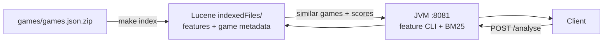
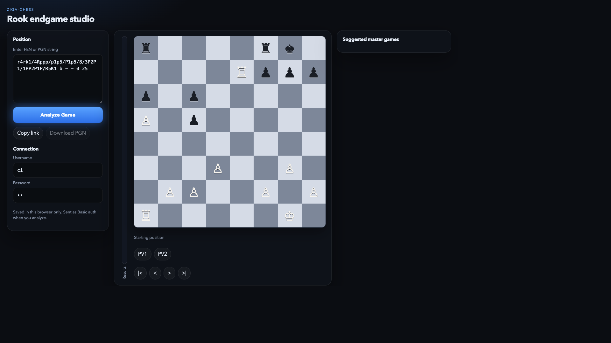
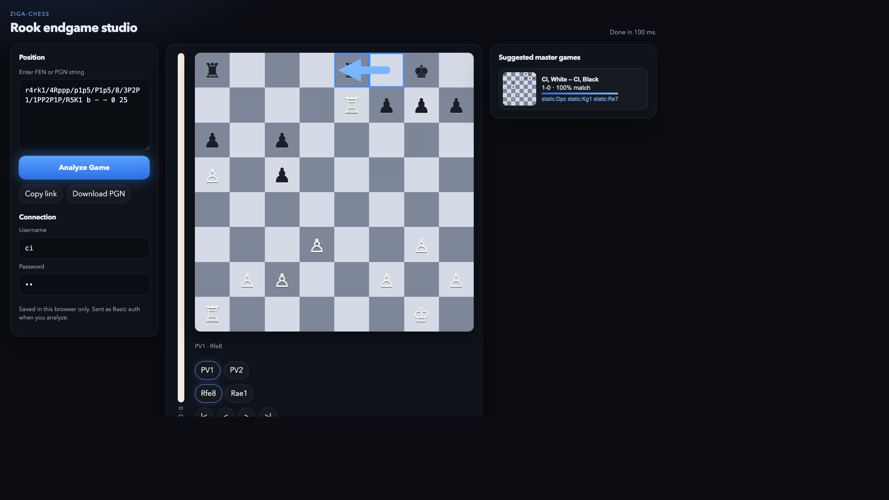

# ziga-chess

Bachelor thesis system for **similar rook-endgame retrieval**: given a FEN, extract chess features, search a Lucene index, and return similar games plus engine lines.

**How the system works (current vs legacy):** see **[docs/ARCHITECTURE.md](docs/ARCHITECTURE.md)** — diagrams for index build, query path, and what changed when Mongo was removed. Service shape: [ADR 0001](docs/adr/0001-single-service.md).

**Wrong assumptions that already broke CI or a local run:** see **[docs/PITFALLS.md](docs/PITFALLS.md)**. Add an entry when you hit a new one.

**Clone and LFS:** [CONTRIBUTING.md](CONTRIBUTING.md). `games/games.json.zip` is Git LFS (`git lfs install && git lfs pull`). Stockfish and the Lucene index are not in the tree.

## Architecture overview



| Step | What happens |
|------|----------------|
| **Index** | Zip → feature tokens + stored metadata → Lucene (no Mongo) |
| **Query** | FEN → JVM runs `python -m chessapp.cli` → Lucene BM25 → plain-text similar games |
| **Add games** | Append to the zip → `make index` → restart the server |

Legacy design used Lucene only for ranking, then **MongoDB** for PGN/players/PVs. That path is gone; details in the [architecture doc](docs/ARCHITECTURE.md).

---

# Project handling

# Tests (pin current behaviour before refactors)

From the repo root:

```bash
make test          # Python + Java
make test-python   # pytest (Stockfish + Java HTTP mocked)
make test-java     # mvn test (temp Lucene fixture; no Mongo)
```

Python coverage includes unit tests for feature extractors, golden snapshots for the README sample FEN, and Flask route integration tests. The feature code is split into `chessapp/features`, `chessapp/engine`, `chessapp/api`, and `chessapp/search_client` (`main.py` is the Flask app the tests import). Java is `chessServer` plus `AuthFilter`, `AnalyseHandler`, `FeatureCli`, `FenParser`, and `LuceneSearchService`, with auth/body helpers, Lucene search against a fixture index, and `IndexBuilder` round-trips.

# Build Lucene index (required for java-server)

The search index is **not** committed (see `java-server/indexedFiles/` in `.gitignore`). Rebuild from `games/games.json.zip` (Git LFS):

```bash
git lfs pull
make index-sample          # ~100 games, quick local smoke
make index                 # full corpus (~900k games; tens of minutes)
# or: make index INDEX_LIMIT=1000 INDEX_DIR=java-server/indexedFiles
```

Pipeline: `scripts/prepare_lucene_docs.py` (static/other/dynamic features + metadata) → `IndexBuilder` (Lucene 8.11). Game metadata (`White`, `Black`, `PGN`, …) is stored **in Lucene** — MongoDB is no longer used.

# Configuration / secrets

Copy `.env.example` → `.env` and set:

- `AUTH_USERNAME` / `AUTH_PASSWORD` (required)
- `LUCENE_INDEX_DIR` / `LUCENE_TOP_K` (optional; default top 20)
- `CHESSAPP_DIR` (directory that contains the `chessapp` package; the image sets `/app/python-server`)
- `STOCKFISH_PATH` (optional; otherwise platform detection under `engine/` relative to the CLI working directory)
- `PORT` (optional; default 8081)
- `CACHE_MAX_ENTRIES` / `CACHE_TTL_SECONDS` / `STOCKFISH_LOCK_TIMEOUT_SECONDS` apply to Flask `main:app` only, not to each CLI process the JVM starts

See [SECURITY.md](SECURITY.md). Hardcoded credentials have been removed.

# Performance

- **Lucene:** one `SearcherManager` per Java process (opened at startup, closed on shutdown). Search acquires and releases a searcher; it does not open a new `DirectoryReader` per request. `maybeRefresh()` sees an in-place commit. A full `make index` still needs a process restart (`OpenMode.CREATE` wipes the directory).
- **Top-N:** Lucene returns at most `LUCENE_TOP_K` hits (default 20), already ranked by BM25. The plain-text body prints that page in score order.
- **Compose `/analyse`:** each request starts `python -m chessapp.cli`, which starts its own Stockfish. The Flask LRU does not survive that process.
- **Flask `main:app`:** plain-text bodies live in an in-process LRU with TTL (default 256 entries, 1 hour). One Stockfish process. A second overlapping `/analyse` that needs the engine gets **503** `engine_busy` (default wait is 0). A cached FEN does not take the lock. Keep a single worker if you run gunicorn yourself.

Rough latency for the README sample FEN `r4rk1/4Rppp/p1p5/P1p5/8/3P2P1/1PP2P1P/R5K1 b - - 0 25`:

| Path | Before | After |
|------|--------|-------|
| Lucene, 40 queries on a 1-doc fixture (this machine) | **~20 ms** opening a `DirectoryReader` every query | **~6 ms** acquire/release on one searcher (about 3×; `LUCENE_BENCH` in `make test-java`) |
| First `/analyse` of the sample FEN | Stockfish depth 12 and a depth-8 PV tree dominate | unchanged; the Lucene hop is the small part |
| Repeat `/analyse` of the same FEN on Flask `main:app` | unbounded dict hit | LRU+TTL hit; skips Stockfish and the search hop |
| Second Flask `/analyse` while the engine is busy | threads share one Stockfish process | **503** `engine_busy` |

The Lucene numbers are a local microbench (same `MatchAllDocsQuery`, tiny fixture), not a full `/analyse`. They show the reader is no longer reopened; the test also checks that 40 searches keep the same `IndexReader` and do not grow open file descriptors. A full `indexedFiles` tree costs more to open, so the gap widens there.

# How to run (Docker Compose — recommended)

```bash
cp .env.example .env          # set AUTH_USERNAME / AUTH_PASSWORD
git lfs pull
make index-sample             # or: make index
docker compose up --build
```

- Board: `http://127.0.0.1:8081/`
- Analyse API: `http://127.0.0.1:8081/analyse`
- Health: `GET /ping` on that same port (always unprefixed, even if `APP_PREFIX` is set)
- Optional `APP_PREFIX` (e.g. `/v1/chess`) is applied to `/analyse` and `/position`. The board stays at `/` and calls that prefixed analyse URL. Leave `APP_PREFIX` empty for local defaults.

```bash
source .env
curl -u "$AUTH_USERNAME:$AUTH_PASSWORD" -H 'Content-Type: application/json' \
  -d '{"FEN":"r4rk1/4Rppp/p1p5/P1p5/8/3P2P1/1PP2P1P/R5K1 b - - 0 25"}' \
  http://127.0.0.1:8081/analyse
```

Stockfish is **downloaded in the image** (not committed). For local non-Docker runs: `./scripts/download_stockfish.sh`.

## Manual (without Compose)

Build the index, package the jar, and run one process. `CHESSAPP_DIR` is `python-server/` so `python -m chessapp.cli` can import the package. The CLI inherits `STOCKFISH_PATH`.

```bash
export AUTH_USERNAME=... AUTH_PASSWORD=...
export CHESSAPP_DIR="$PWD/python-server"
export STOCKFISH_PATH="$PWD/python-server/engine/stockfish"
export LUCENE_INDEX_DIR="$PWD/java-server/indexedFiles"
java -jar java-server/target/my-maven-docker-project.jar
```

Listens on port 8081 (`PORT` overrides). The same process serves the board at `/`.

Open `http://127.0.0.1:8081/`. The page is two columns. The left column shows the saved username, a box for a FEN or a PGN, and Analyze Game. Enter the Basic auth user and password in that card. The sample FEN is filled in. The right column is the board. The current move is a blue arrow. Engine lines under the board are `PV1` and `PV2`. Suggested games sit in Analyzed Games History & Review: a thumbnail, the players, the result, and a match percent against the strongest hit in that response (a BM25 score, not a win probability or a date). Recent positions from this browser are listed there too. The bar beside the board counts `1-0`, draws, and `0-1` in the suggested games. It is not an engine evaluation. Credentials and the recent-position list stay in the browser's local storage.

A shared position is `/?fen=` plus the FEN, URL-encoded (`/` as `%2F`, spaces as `%20`). Copy link writes that URL. An invalid `fen` parameter leaves the sample position and shows an error.

Download PGN saves the `similarPgn` field: one game per similar hit, separated by a blank line. Movetext-only games gain `[Event]`, `[White]`, `[Black]`, `[Result]`, `[FEN]`, and `[SetUp "1"]`. A stored PGN that already starts with `[` is copied through.

Each similar game includes `explanation`: a BM25 score for `static`, `other`, and `dynamic`, plus up to five matched tokens. The board lists those tokens under the game. `Accept: text/plain` leaves the explanation out so the thesis body stays the stored fields.





# R&D
- improve game attributes in feature extraction, then `make index` to refresh `indexedFiles`

# Request example
- url: http://127.0.0.1:8081/analyse
- method `POST`
- body:

`{
	"FEN": "r4rk1/4Rppp/p1p5/P1p5/8/3P2P1/1PP2P1P/R5K1 b - - 0 25"
}`
- headers: `Authorization: Basic ...`. Optional `Accept: text/plain` selects the legacy body.
- example response (`application/json`; schema in [openapi.yaml](openapi.yaml)):

```json
{
  "fen": "r4rk1/4Rppp/p1p5/P1p5/8/3P2P1/1PP2P1P/R5K1 b - - 0 25",
  "principalVariations": [
    { "id": 1, "pgn": "25... Rfe8 ..." },
    { "id": 2, "pgn": "25... f6 ..." }
  ],
  "similarGames": [
    {
      "rank": 0,
      "name": "Game#894776.txt",
      "white": "Christiansen,Johan-Sebastian",
      "black": "Guliev,L",
      "result": "1-0",
      "endgameFen": "r4rk1/4Rppp/p1p5/P1p5/8/3P2P1/1PP2P1P/R5K1 b - - 0 25",
      "pgn": "1. e4 c5 ...",
      "pv1": "25... Rfe8 ...",
      "pv2": "25... f6 ...",
      "score": 86.85
    }
  ],
  "meta": { "engineDepth": 12, "limitDepth": 8, "tookMs": 1234 }
}
```

`Accept: text/plain` returns the previous thesis layout (`PV1` / `PV2`, then `Game #N`). Flask `main:app` still returns that text. Compose serves the JVM.

# Sources
- https://stockfishchess.org
- https://repozitorij.uni-lj.si/IzpisGradiva.php?id=153478&lang=slv
- [SIGIR '14: Proceedings of the 37th international ACM SIGIR conference on Research & development in information retrieval](https://dl.acm.org/doi/10.1145/2600428.2609605)

# Chess results questionnaire (system answers)
1 A C B
2 C A B
3 C B A
4 B A C
5 A C B
6 C A B
7 B C A
8 B A C
9 C A B
10 C B A
11 C A B
12 C A B
13 B C A
14 A C B
15 A C B