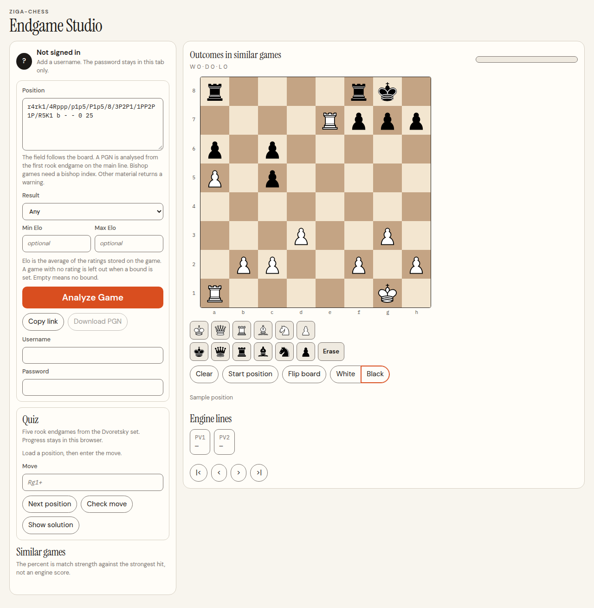
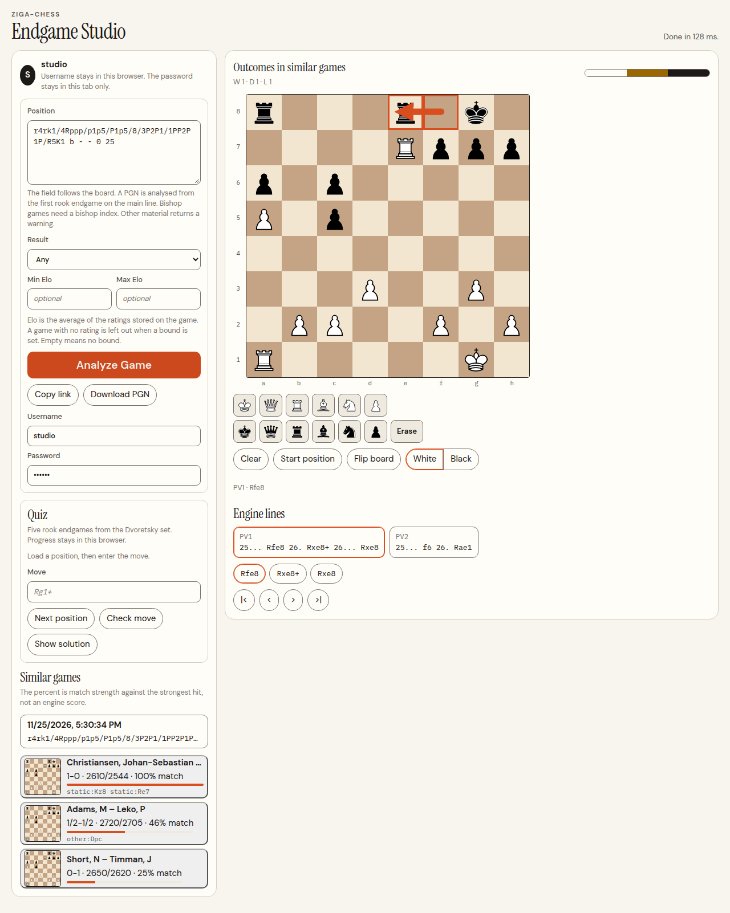
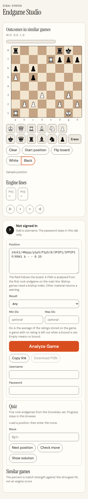
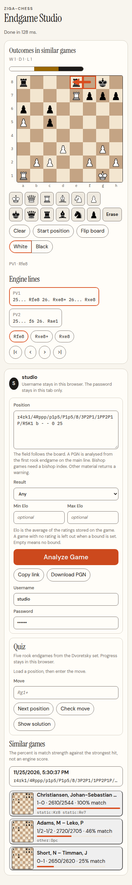
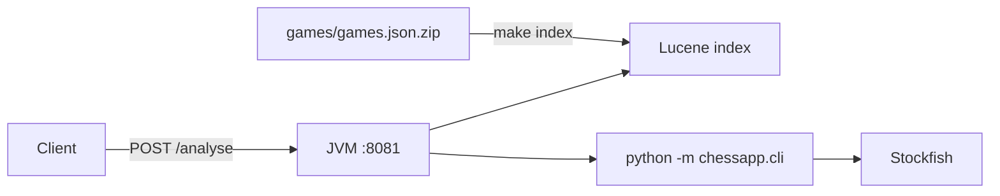

# Endgame Studio

ziga-chess finds **similar rook and bishop endgames**. Set up a position, or paste a FEN or a PGN. The studio extracts features, searches a Lucene index, and returns engine lines plus games that share that endgame shape.

The public server is one process on port **8081**: a Java 17 HTTP server (Lucene) with a Python feature CLI and Stockfish beside it, and the board served from the same process. Service shape: [ADR 0001](docs/adr/0001-single-service.md). Data flow: [docs/ARCHITECTURE.md](docs/ARCHITECTURE.md). Mistakes that already broke a run: [docs/PITFALLS.md](docs/PITFALLS.md).

## Quick start

`games/games.json.zip` is Git LFS. Stockfish and the Lucene index are not in the tree. See [CONTRIBUTING.md](CONTRIBUTING.md).

```bash
cp .env.example .env          # AUTH_USERNAME and AUTH_PASSWORD
git lfs install && git lfs pull
make index-sample             # or: make index
docker compose up --build
```

Open [http://127.0.0.1:8081/](http://127.0.0.1:8081/). Health is `GET /ping` on that same port. `APP_PREFIX` (for example `/v1/chess`) is applied to `/analyse`, `/position`, and `/quiz` only. The board stays at `/` and calls the prefixed URLs. Health checks stay on unprefixed `/ping`.

```bash
source .env
curl -u "$AUTH_USERNAME:$AUTH_PASSWORD" -H 'Content-Type: application/json' \
  -d '{"FEN":"r4rk1/4Rppp/p1p5/P1p5/8/3P2P1/1PP2P1P/R5K1 b - - 0 25"}' \
  http://127.0.0.1:8081/analyse
```

## The studio

The board is the position. Click a piece in the palette and then a square, or drag a piece. Clear, the starting position, side to move, and flip sit under the board. Ranks and files follow the flip. The FEN field stays in step with the board and says when the text is not a valid FEN. A PGN in that field is analysed from the first rook endgame on the main line.

Filters are result and Elo. The Elo boxes are empty until you type a number. The bar above the board is **Outcomes in similar games**, with white wins, draws, and black wins. It is not an engine evaluation.

Engine lines are PV1 and PV2. A shared position is `/?fen=` plus the FEN. Download PGN saves `similarPgn`. The quiz is five rook endgames from the Dvoretsky set. The username stays in this browser. The password stays in this tab only.









A position of kings, bishops, and pawns, with at least one bishop, is a bishop endgame. `games/games.json.zip` has no bishop games. `make index-bishops` loads the studies in `fixtures/bishop-docs.ndjson`. Run it again after `make index`, which wipes the directory. Until those studies are loaded, a bishop query returns an empty list and `warning`. A queen, a knight, or rooks mixed with bishops is `other`.

## API

`POST /analyse` with `Authorization: Basic` and `Content-Type: application/json`. The schema is [openapi.yaml](openapi.yaml).

```json
{
  "FEN": "r4rk1/4Rppp/p1p5/P1p5/8/3P2P1/1PP2P1P/R5K1 b - - 0 25",
  "result": "1-0",
  "minElo": 2200,
  "family": "rook"
}
```

`result` is `1-0`, `0-1`, or `1/2-1/2`. `minElo` and `maxElo` bound the game's Elo: the average of the two ratings when both are present, otherwise the one that is present. A game with no rating is left out when either bound is set. `family` is `rook` or `bishop`. Omitting the fields leaves the BM25 ranking unchanged.

A PGN is `{"PGN":"..."}`. The response `fen` is the first rook endgame on the main line, and `endgamePly` is its half-move index. A game that never reaches one returns `no_endgame`.

`Accept: text/plain` returns the thesis layout (`PV1` / `PV2`, then `Game #N`) and leaves `explanation` out. The default body is JSON: `principalVariations`, `similarGames` (with `explanation` tokens), `similarPgn`, and `meta`. `GET /quiz` lists the five positions. `POST /quiz` checks a SAN against the first move of that position's PV1, or reveals it.

## Architecture



The index stores features and the game metadata. There is no Mongo round-trip. `make index` rebuilds the directory (`OpenMode.CREATE`); restart the server after that. `make index-update` commits into the same directory, and the next search sees it.

One image: JRE, `python3`, the `chessapp` package, and Stockfish. `CHESSAPP_DIR` is the directory that contains that package. The image listens on 8081. Do not add a second compose service.

## Develop

```bash
make test          # pytest and JUnit
make index-sample  # about 100 games
make index         # full corpus, then restart the server
make index-bishops # bishop studies; run again after make index
```

Python pins, including `numpy>=1.26,<2`, live in `python-server/requirements.txt`. `make test-python` installs that file.

Without Compose, after the index exists:

```bash
export AUTH_USERNAME=... AUTH_PASSWORD=...
export CHESSAPP_DIR="$PWD/python-server"
export STOCKFISH_PATH="$PWD/python-server/engine/stockfish"
export LUCENE_INDEX_DIR="$PWD/java-server/indexedFiles"
java -jar java-server/target/my-maven-docker-project.jar
```

`./scripts/download_stockfish.sh` fetches the binary for a local run. The image downloads it during the build.

Credentials come from the environment. See [SECURITY.md](SECURITY.md). The thesis questionnaire answers are in [docs/thesis.md](docs/thesis.md).

## Sources

- https://stockfishchess.org
- https://repozitorij.uni-lj.si/IzpisGradiva.php?id=153478&lang=slv
- [SIGIR '14: Proceedings of the 37th international ACM SIGIR conference on Research & development in information retrieval](https://dl.acm.org/doi/10.1145/2600428.2609605)

Piece drawings are Colin M.L. Burnett's cburnett set (GPL-2.0-or-later and CC-BY-SA-3.0), kept unmodified under `java-server/src/main/resources/web/pieces/`. Instrument Serif, DM Sans, and IBM Plex Mono are under the SIL Open Font License in `java-server/src/main/resources/web/fonts/OFL.txt`.
