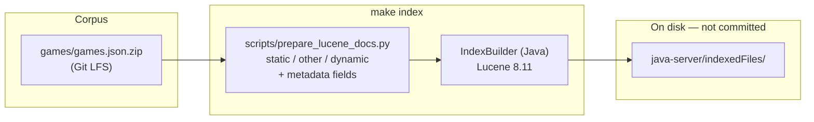
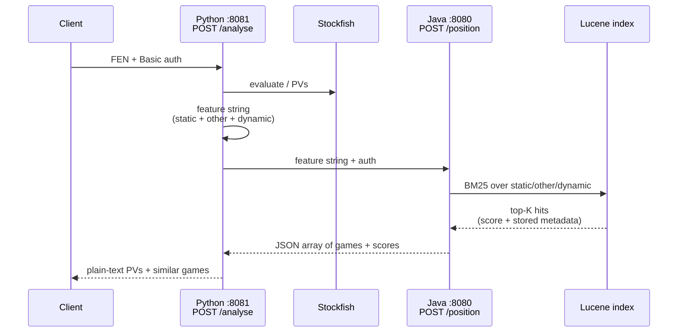
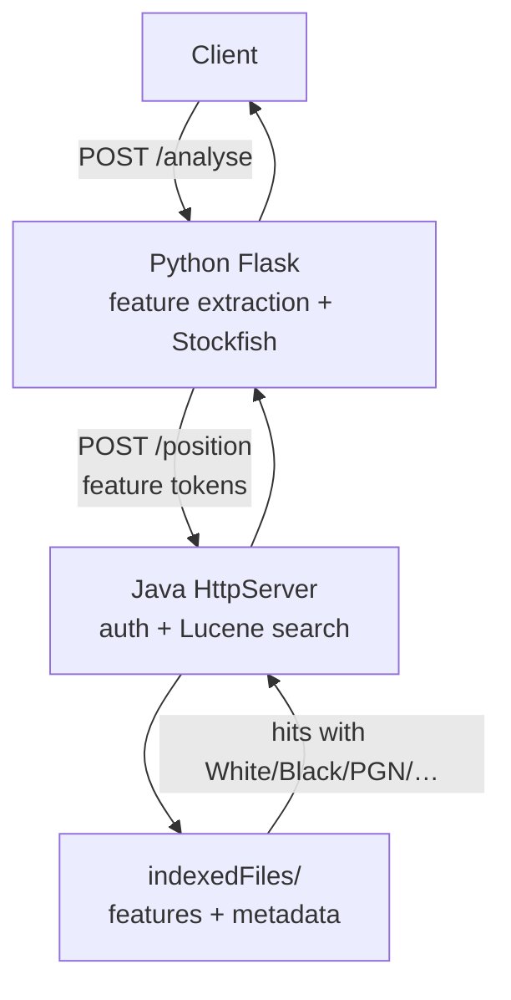
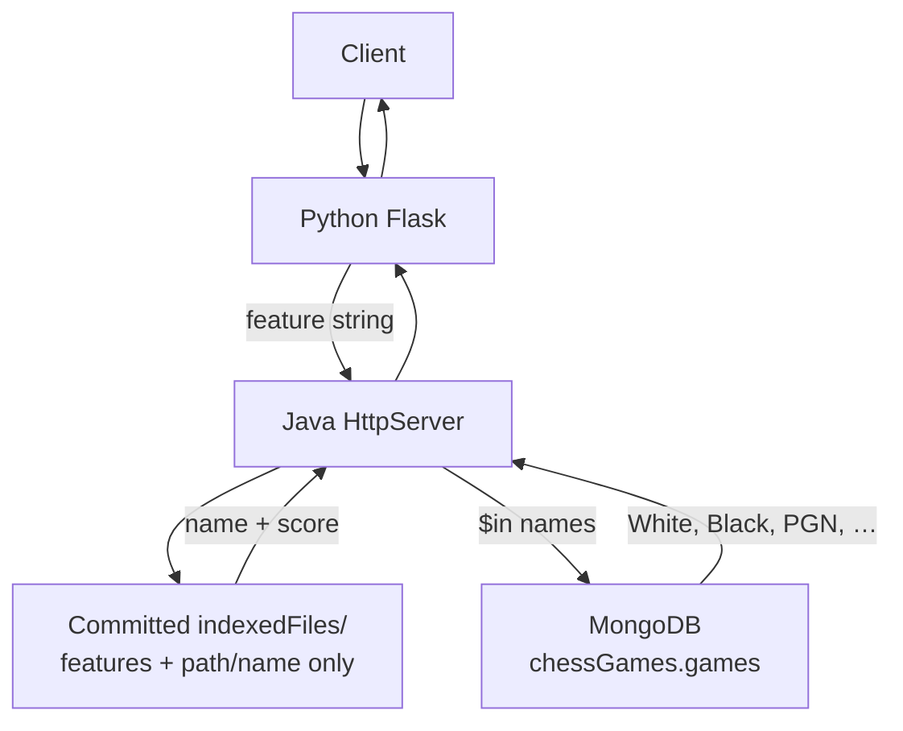
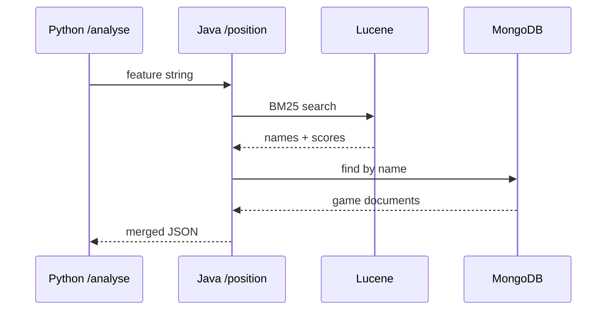

# Architecture: similar rook-endgame search

This project finds **similar rook endgames** for a position (FEN). It extracts chess features, searches a Lucene index with BM25, and returns similar games plus principal variations.

This page describes the **current** data/query flow and how it differs from the **legacy** (pre–PR #15) design.

The target is one JVM process (Lucene in-process, Python features via a subprocess). That is [ADR 0001](adr/0001-single-service.md). The two-service flow below is still what runs.

---

## At a glance

| | Legacy | Current |
|---|--------|---------|
| Game corpus | `games/games.json.zip` (+ copy in Mongo) | `games/games.json.zip` only |
| Search index | Prebuilt Lucene files committed to git | Built locally with `make index` |
| Similar-game metadata | MongoDB `chessGames.games` | **Stored fields on Lucene documents** |
| Runtime deps for `/position` | Lucene **and** Mongo | Lucene index on disk only |
| Adding games | Update zip **and** re-index **and** reload Mongo | Append to zip → `make index` → restart Java |

---

## Current architecture

### 1. Offline: build the index

Source of truth is the zip (NDJSON of games). Features are computed from each game’s `endgameFEN` and PV lines; metadata is written **into** the same Lucene document.



**What each Lucene document holds**

| Role | Fields |
|------|--------|
| Search (tokenized) | `static`, `other`, `dynamic` |
| Stored metadata (for the API response) | `name`, `White`, `Black`, `Result`, `PGN`, `PV1`, `PV2`, `endgameFEN` |

If you add games: append JSON lines to the corpus, refresh the zip, run `make index` again (full rebuild today), restart the Java server. The running process keeps one `SearcherManager` and calls `maybeRefresh()` on each search, so an in-place commit is picked up. `make index` opens the index with `OpenMode.CREATE` (it wipes the directory), so restart Java after a full rebuild.

### 2. Online: analyse a position



`python -m chessapp.cli` runs the same feature extraction and prints JSON (`features`, `pv1`, `pv2`) for the future in-process hop. The HTTP path above is still what serves clients.

Lucene does **both** similarity search **and** serving game data. MongoDB is not involved.



---

## Legacy architecture (before PR #15)

The index only stored enough to identify a game (effectively a path/`name`). After BM25, Java queried **MongoDB** to load PGN, players, PVs, etc.





**Problems with legacy**

- Two sources of truth (zip/index vs Mongo) could drift
- Server would not run without a private Mongo URI and data
- Large Lucene segments + `write.lock` lived in git
- No checked-in recipe to rebuild the index after changing features

---

## Mental model

```text
  games.json.zip          make index              query time
 ┌──────────────┐      ┌─────────────┐      ┌──────────────────┐
 │ game records │ ───► │ Lucene docs │ ───► │ BM25 + hydrate   │
 │ FEN, PGN, PV │      │ features +  │      │ similar games    │
 │ players, …   │      │ metadata    │      │ (no Mongo)       │
 └──────────────┘      └─────────────┘      └──────────────────┘
```

- **Zip** = editable corpus  
- **Index** = derived artifact (gitignore; rebuild when corpus or feature code changes)  
- **Python** = understand the *query* position (Stockfish + features)  
- **Java / Lucene** = find and return *similar* games  

Python is split under `python-server/chessapp/` (`features`, `engine`, `api`, `search_client`). `main.py` only exposes the gunicorn app. The Stockfish binary still lives in `python-server/engine/` (not a Python package). Java HTTP startup is `chessServer`; auth is `AuthFilter`, `POST /position` is `FenParser`, and BM25 is `LuceneSearchService`.  

---

## Related commands

```bash
git lfs pull
make index-sample    # small index for local smoke tests
make index           # full corpus
make test            # unit + integration tests (mocked Stockfish / fixture index)
```

See also [SECURITY.md](../SECURITY.md) for auth env vars and the root [README](../README.md) for run instructions.
